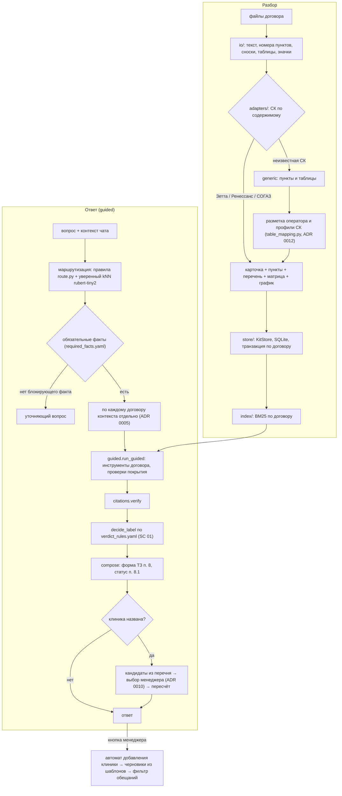
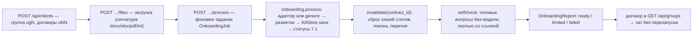

# Архитектура, модель и обработка документов

ТЗ п. 10.6. Описано то, что есть в коде на 26.10.2026 (коммит 3837d51). Ссылки — на файлы и функции; номера строк
меняются, поэтому даны только там, где без них не найти. Главный план — `docs/plan.md` §4–6, контракты —
`docs/CONTRACTS.md`, решения — `docs/decisions/` (ADR 0001–0013).

## 1. Идея

Договор не режется на куски для векторного поиска, а разбирается в структуру: карточка договора, пункты
с восстановленными номерами, перечень клиник, матрица «программа × вид помощи», график взносов. Ответ по умолчанию
строит код (режим `guided`, ADR 0009): по сценарию вопроса он сам вызывает инструменты одного договора, собирает
утверждения со ссылками, проверяет ссылки и ставит метку по правилам конфига. Модель необязательна: с сильной
моделью доступен режим `agent` (модель вызывает те же инструменты), с малой — только формулировка вывода.

Причина — целевой сервер 2–4 ГБ без видеокарты и без платных ключей (ADR 0009): модели 0,6–1,7B на замере не лучше
правил в выборе сценария и выдумывают слоты, а все данные для типовых ответов уже структурированы.

## 2. Поток

Точка входа движка — `engine.answer` (`src/dms_core/engine.py`); порядок шагов — в шапке файла. Режим выбирает
`guided.engine_mode`: `DMS_ENGINE_MODE=auto|guided|agent`, по умолчанию `auto` — `guided`, если модели нет или
она «малая» (`DMS_LLM_SMALL=1`), иначе `agent`; `agent` без модели — запасной `extractive` (найденные пункты без
вывода).

## 3. Модули

| Модуль | Назначение |
|---|---|
| `dms_core/io/` | чтение DOCX (`docx_reader.py`, нумерация по `numbering.xml`), XLSX (`xlsx_reader.py`, защита от zip-бомбы), PDF (`pdf_reader.py`, дочерний процесс, без OCR), TXT |
| `dms_core/kit.py` | опись комплекта: ГК → договоры → файлы и типы по `config/doc_types.yaml` |
| `dms_core/adapters/` | формат СК → `ParsedContract`: `zetta.py`, `renaissance.py`, `sogaz.py`, `generic.py`; документы группы — `group_docs.py` |
| `dms_core/store/` | `KitStore` (SQLite), дедуп одинаковых текстов |
| `dms_core/index/` | BM25 + морфология pymorphy3 по пунктам одного договора (`search.py`); энкодер rubert-tiny2 ONNX (`embed.py`) |
| `dms_core/tools/` | инструменты договора и реестр с привязкой договора (`registry.py`); перечень и поиск клиник (`clinics.py`) |
| `dms_core/scenarios/` | `route.py` (сценарий и слоты правилами), `knn_route.py` (kNN), `clarify.py`, `sc01_refusal.py` (метка), `clinics_pick.py`, `add_clinic.py`, `drafts.py` |
| `dms_core/guided.py` | ответ кодом: проверки вида помощи, покрытия, клиники, кандидаты клиники |
| `dms_core/agent.py` | цикл «модель ↔ инструменты» по одному договору (режим `agent`) |
| `dms_core/citations.py` | проверка ссылок и доказательств «нет в документах» |
| `dms_core/precedence.py`, `conflicts.py` | старшинство документов и противоречия |
| `dms_core/compose.py` | форма ответа ТЗ п. 8 и статус п. 8.1 |
| `dms_core/onboarding.py` | подключение клиента: разбор договора из загруженных файлов, сброс кэшей, самопроверка (ADR 0011) |
| `dms_core/table_mapping.py` | разметка таблиц перечня оператором, подписи, профили СК, проверка содержимого (ADR 0012) |
| `dms_core/promises.py` | поиск запрещённых обещаний по `config/forbidden_promises.yaml` |
| `dms_core/llm/` | провайдеры моделей, промпты, цены (ADR 0002) |
| `dms_api/` | веб-сервис Starlette: `app.py` (маршруты, SSE), `service.py`, `store.py` (чаты, клиенты, разметки), `security.py`, страницы |
| `config/` | все правила выводов, маркеры, примеры kNN, промпты и тексты (`docs/rules.md` п. 5) |

## 4. Обработка документов

### 4.1 Чтение DOCX с нумерацией Word

Pandoc не используется: он теряет автонумерацию Word («2.6.1» превращается в «1.»). Свой разбор
(`io/docx_reader.py`): номера пунктов считаются по `word/numbering.xml` и `styles.xml` (экземпляры списков,
`lvlOverride`, `startOverride`, `lvlRestart`, `isLgl`, `numStyleLink`); скрытый текст пропускается, но двигает
счётчик, как в Word; сноски вклеиваются в пункт; картинка в ячейке → маркер значка (у Ренессанса значок означает
«по записи через страховщика»). Сверка с LibreOffice на комплекте: 19 файлов с автонумерацией, 3034 из 3034 номеров
совпали (`docs/status/stage-w1-io.md`).

### 4.2 Адаптеры трёх СК и запасной разбор

Адаптер выбирается по содержимому документа (преамбула, структура таблиц), не по имени папки
(`adapters/__init__.py`). Нет подходящего — `generic` (пункты и таблицы без клиник).

| СК (ГК) | Что разбирает адаптер |
|---|---|
| Зетта (ГК 1) | один docx с приложениями; перечень — одностолбцовая таблица, связь строк порядком: вариант → вид помощи → франшиза → клиника → адрес; график взносов |
| Ренессанс (ГК 2) | договор + программа; таблица перечня на программу; коды и значки → поля строки; примечания → условие доступа; матрица из заголовков перечня и текста условий |
| СОГАЗ (ГК 3) | договор, программа, памятка, список МО в xlsx (программа × клиника × адрес × виды помощи); франшиза «—» — не применяется, пусто — не указана |

Адаптеры сверяют числа: «премия × численность» = итог договора = сумма графика взносов. Каталог «ЛПУ_Регионы» и
правила НС хранятся как документы группы без `contract_id` и в инструментах договора не участвуют (`docs/rules.md` п. 0а).

### 4.3 Статусы документа (ТЗ п. 7.1)

`received → extracted → checked → indexed → ready`, при сбое — `error` с причиной (`onboarding.mark_statuses`;
общий конвейер импорта и подключения клиента). «Полнота проверена»: у договора есть пункты с номерами, у перечня —
строки клиник, карточка сошлась.

### 4.4 Хранилище и поиск

- `data/derived/kit.sqlite` — группы, договоры, документы, пункты, клиники, матрица. Одинаковый текст хранится один
  раз, но каждый пункт ссылается на документ своего договора. `KitStore.save` пишет или заменяет один договор одной
  транзакцией.
- `data/app/app.sqlite` — чаты, запросы, сообщения, черновики, реестр клиентов и заданий, разметки таблиц, профили
  СК (`dms_api/store.py`).
- Поиск — BM25 по леммам pymorphy3 по пунктам одного договора (`index/search.py`), запрос расширяется синонимами
  видов помощи из `config/care_types.yaml`. Векторного поиска по документам нет: энкодер используется только для
  выбора сценария вопроса.

## 5. Конвейер ответа guided (ADR 0009)

1. **Маршрутизация** (`guided.choose_scenario` → `route.route`). Сценарий — один из четырёх (SC 01 отказ / «положено
   ли»; SC 02 информация, клиника, взнос). Сначала правила по маркерам `config/route_markers.yaml`; затем kNN по
   эмбеддингам rubert-tiny2 (ONNX int8, 28 МБ, `scenarios/knn_route.py`; примеры — свои формулировки в
   `config/route_examples.yaml`, не эталоны) — он побеждает правила, только если уверен (отрыв ≥ `min_margin` 0,5).
   Явные маркеры отказа всегда дают SC 01 (`route.firm_sc01`). Точность выбора сценария на 57 вопросах эталонов
   (без holdout): правила 0,68, kNN 0,75, вместе 0,81 (ADR 0009). Слоты (клиника, услуга, вид помощи, программа,
   город, улица) — правилами; слот клиники дополняется по перечню договора (номер, второе слово, строчные названия).
2. **Уточнения** (`scenarios/clarify.split_missing`, `config/required_facts.yaml`): блокирующий факт отсутствует —
   уточняющий вопрос вместо ответа; неблокирующий — ответ даётся, недостающее попадает в «что неизвестно».
3. **По договору** (`guided.run_guided`; контекст ГК — отдельный прогон на каждый договор). SC 01: программа →
   матрица и вид помощи (`check_care`) → покрытие услуги и исключения по пунктам программы (`check_coverage`, маркеры
   `config/coverage_markers.yaml`) → клиника по перечню программы (`check_clinic`) → условия строки (франшиза,
   «по направлению», примечание) → альтернативы. SC 02: взнос — `payments_next` от даты контекста; клиники —
   `clinics_query`; сравнение программ; прочее — поиск по пунктам. Каждое утверждение — свой дословный фрагмент из
   результата инструмента. Договор без программ (generic) — найденные пункты, метки нет.
4. **Проверка ссылок** — `citations.verify` (раздел 7).
5. **Метка SC 01** — `sc01_refusal.decide_label` по правилам `config/verdict_rules.yaml` сверху вниз (раздел 8).
6. **Сборка** — `compose`: форма ТЗ п. 8, статус уверенности п. 8.1, вывод — шаблоны `config/texts_ru/ui.yaml`
   (с моделью и `DMS_GUIDED_LLM_SUMMARY=1` — формулировка модели, проверенная `checked_summary`).

Принцип: при сомнении — «недостаточно данных», а не догадка. `not_found` («не нашли») никогда не даёт «нельзя»;
«можно» и «нет в перечне» по клинике — только после подтверждения клиники менеджером.

## 6. Выбор клиники менеджером (ADR 0010)

Название клиники в свободном тексте ненадёжно: на ревизиях 4–5 строгое сопоставление давало ложные «можно» (чужая
клиника с похожим названием) и ложные «нельзя» (латиница). Поэтому клиника из вопроса не угадывается:

- guided собирает до `CLINIC_CHOICE_MAX` = 6 кандидатов из перечня программы договора (строгие совпадения, улица
  обращения, подходящий вид помощи — раньше) и отдаёт их в `Answer.clinic_choices` по договорам;
- менеджер выбирает строку, находит любую строку перечня поиском (`GET /api/requests/{id}/clinic-candidates`:
  название, юрлицо, город, адрес, опечатки, латиница) или жмёт «Нет в перечне программы»
  (`POST /api/requests/{id}/clinic`); сервис проверяет, что строка — из перечня этой программы этого договора, и
  пересчитывает ответ с `engine.answer(..., clinic_picks=...)`;
- правила `covered` («можно») и `clinic_absent` («нельзя», нет в перечне) срабатывают только с
  `clinic_confirmed: yes`; клиника названа, но не подтверждена — правило `clinic_unresolved` → «недостаточно
  данных, выберите клинику из перечня»;
- выбор живёт в одном пересчёте: новый вопрос сбрасывает выборы; в контексте ГК выбор — по каждому договору.

## 7. Проверка ссылок (`citations.py`, ADR 0003)

`verify` оставляет ссылку, только если: её `ref` вернул инструмент в этом прогоне и он принадлежит договору ответа;
цитата найдена в тексте пункта (точно после нормализации или нечётко — без изменения отрицаний, ограничений и
чисел); цитата связана с утверждением по значимым леммам или числам; для строки перечня — совпадают id и название
клиники. На экран идёт фрагмент из самого документа по смещениям. Утверждение без живых ссылок выбрасывается.

«Нет в документах» (`absent`) — отдельное доказательство: вида помощи нет в матрице программы (строка
`present=false`), клиники нет в перечне программы при непустом перечне, документ нужного типа разобран
(`verdict_rules.yaml` `absent_sources`). Иначе `absent` → `not_found` (`docs/rules.md` п. 3а).

## 8. Метки и статусы кодом

Правила `config/verdict_rules.yaml` (сверху вниз, первое подходящее): `excluded` (исключение) → «нельзя»;
`care_absent` (вида помощи нет в матрице) → «нельзя»; `clinic_absent` (нет в перечне, клиника подтверждена) →
«нельзя»; `contradiction` → «при условиях, нужно подтверждение СК»; `clinic_unresolved` → «недостаточно данных»;
`conditions` → «при условиях»; `covered` (вид помощи и клиника есть, условий нет, клиника подтверждена) → «можно»;
иначе — «недостаточно данных». Если ни одна ссылка не прошла проверку — «недостаточно данных».

Противоречия (`conflicts.py`): разные уровни по `config/precedence.yaml` — позиция по старшему документу и обе
цитаты; равные уровни — обе цитаты без позиции. Статус ТЗ п. 8.1: противоречие > нужно уточнение > данных
недостаточно > есть подтверждение; для ГК — худший из статусов договоров.

## 9. Изоляция договоров (ADR 0005)

Условия одного договора не переносятся на другой; обеспечивает код, а не промпт:

1. Любое чтение условий в `KitStore` требует `contract_id` (без него — `ValueError`), каждый SQL — с
   `WHERE contract_id = ?`; сохранение отвергает строки чужого договора.
2. Индекс поиска — свой у каждого договора.
3. Инструменты привязаны к договору замыканием (`tools/registry.bind_tools` для агента, `guided.bound_executor`
   для guided); у инструментов, видимых модели, нет параметра `contract_id`, лишний аргумент отвергается.
4. `citations.verify` выбрасывает ссылку на другой договор и считает её в метрике «чужой договор»; ссылка на правила
   СК или каталог отбрасывается как «не условия договора».
5. Контекст ГК — отдельный прогон на каждый договор (до 5 параллельно, `engine.MAX_PARALLEL_CONTRACTS`); ответ —
   блоки по договорам.
6. Выбор клиники (ADR 0010) принимается только строкой перечня программы своего договора.
7. Договор клиента получает свой `contract_id` (`uNN`, группа `ugN`, не пересекаются с `cNN`/`gkN` комплекта);
   разметка таблиц и строки перечня — по договору, профиль СК хранит только разметку колонок, не данные.

Тесты: `tests/store/test_store_db.py::test_isolation_every_read_returns_only_own_contract`,
`tests/tools/test_tools_v1.py::test_tools_isolation_two_near_identical_contracts`. На всех прогонах эталонов
ссылок на чужой договор — 0 (`docs/test_report.md`).

## 10. Подключение клиента (ADR 0011)

- Файлы — `data/derived/clients/<ugN>/<uNN>/` (общие для группы — `_group/`), реестр — в `data/app/app.sqlite`.
- Задания идут по одному договору за раз (`HeavyGate`, сервер 2–4 ГБ); остальные договоры и открытые чаты не
  затрагиваются. Сбой — `failed`, база не портится.
- Готовность (`onboarding._readiness`): `ready` — есть пункты, программы, перечень и матрица; `limited` — договор
  в поиске без перечня или матрицы; `failed` — нет разобранных пунктов.
- Повторная обработка заменяет договор целиком; общий импорт комплекта после пересборки базы заново разбирает
  договоры клиентов по снимку файлов последней успешной обработки (`onboarding.reparse_all`).
- API — `docs/CONTRACTS.md` §9.

## 11. Разметка таблиц оператором (ADR 0012–0013)

Для неизвестной СК (`generic`) или при флажке «Не распознавать формат» (`force_generic`):

- `GET /api/clients/contracts/{uNN}/tables` — таблицы документов договора (docx — таблицы, xlsx — листы), первые
  строки, подпись, предложение разметки; `POST …/tables/try` — пробный разбор без сохранения;
  `PUT …/tables/mapping` — сохранение, по флажку — профиль СК; `GET/DELETE /api/insurer-profiles`.
- Разметка (`TableMapping`): строка заголовка или «заголовка нет»; роли колонок (название клиники обязательно; юрлицо,
  адрес, город, вид помощи, программа, франшиза, код, по направлению, примечание); программа — из колонки,
  постоянная или из названия таблицы / строк-вариантов; «применить ко всем таблицам с такой же раскладкой».
- Подпись таблицы — нормализованный заголовок или раскладка колонок (`table_mapping.signature`,
  `layout_signature`). Профиль применяется сам только при той же СК, сильной подписи и прошедшей проверке
  содержимого; иначе — только предложение.
- Проверка содержимого (`table_mapping.content_check`): таблица, не похожая на перечень (например, таблица премий),
  — 422 `mapping_suspicious`, сохранить можно только с подтверждением. Строка перечня без вида помощи не даёт
  «клиника в перечне» для метки.
- Строки перечня получают `source_ref` строки таблицы и проверяются `citations.verify` как строки перечня.
- Матрица видов помощи по разметке (ADR 0013, `role=care_matrix`, широкая/длинная таблица, `derive_care`) —
  контракт (`docs/CONTRACTS.md` §11) и поле схемы есть, код разбора — этап w10, в этой версии не реализован. Поэтому
  у размеченного договора readiness `limited`, вопросы о покрытии вида помощи — «недостаточно данных».

## 12. Память и сервер 2–4 ГБ (ADR 0009)

| Где | Память |
|---|---|
| macOS, сервис без энкодера, после двух ответов | 107 МБ |
| macOS, с энкодером | 231 МБ (первый ответ 1,0 с — загрузка энкодера, далее 0,16 с) |
| Docker (Linux, `mem_limit` 2 ГБ), после ответа, без импорта | 150 МБ |
| Docker, сразу после импорта комплекта в том же процессе | 613 МБ (пик разбора) |

Модель на сервер не ставится: по замеру qwen3:0.6b / 1.7b выбирают сценарий не лучше правил (0,72 / 0,56 против
0,68 у правил и 0,81 у правил с kNN), выдумывают слоты (30 и 10 из 57 вопросов) и на CPU отвечают за секунды
вместо миллисекунд. Подключение клиента обрабатывает один договор за раз. Импорт комплекта на 2 ГБ лучше делать до
начала работы или перезапускать сервис после него.

## 13. API

Маршруты — `dms_api/app.py` (`Route(...)`), тела и ответы — `docs/CONTRACTS.md` §8–11. Ошибки —
`{"error": {code, message, field}}` по-русски.

| Маршрут | Что делает |
|---|---|
| `GET /`, `/documents`, `/about`, `/healthz`, `/version` | страницы и служебные |
| `GET /api/groups`, `GET /api/contracts/{id}`, `GET /api/examples` | контексты, карточка договора, примеры |
| `GET/POST /api/documents`, `GET /api/documents/{id}`, `…/clause`, `…/clauses` | документы, пункты, источник для панели |
| `GET/POST /api/documents/import-kit` | импорт комплекта в фоне и его состояние |
| `GET/POST /api/clients`, `POST /api/clients/{ugN}/contracts` | клиенты и их договоры |
| `POST /api/clients/contracts/{uNN}/files`, `PATCH/DELETE …/files/{name}` | файлы договора клиента |
| `POST /api/clients/contracts/{uNN}/process`, `GET /api/clients/jobs/{id}` | обработка и её ход |
| `GET …/tables`, `POST …/tables/try`, `PUT/DELETE …/tables/mapping` | разметка таблиц |
| `GET /api/insurer-profiles`, `DELETE /api/insurer-profiles/{id}` | профили СК |
| `GET/POST /api/chats`, `GET /api/chats/{id}`, `GET/POST …/requests` | чаты и запросы |
| `GET /api/requests/{id}`, `POST …/messages` | запрос; вопрос → ответ (с `Accept: text/event-stream` — поток стадий) |
| `POST /api/requests/{id}/clinic`, `GET …/clinic-candidates` | выбор клиники и поиск по перечню |
| `POST …/automation/add-clinic`, `…/automation/step` | автомат добавления клиники |
| `POST …/close`, `…/reopen`, `…/rate`, `PATCH /api/drafts/{id}` | закрыть, вернуть, оценить; правка черновика |

## 14. Автомат добавления клиники (ТЗ п. 5.2.2, ADR 0004)

Состояния и переходы — `config/add_clinic.yaml`, код — `scenarios/add_clinic.py`. Запуск — только кнопкой
менеджера; начальное состояние определяет код через перечень (клиника в программе → альтернатива найдена; нет →
не в программе; не хватает данных → недостаточно). Ветку «бесплатно / платно» определяет ответ СК, который вводит
менеджер; клиника «добавлена» только в запросе и только после ответа СК, документы договора не меняются. Черновики
HR и СК — шаблоны `config/texts_ru/drafts.yaml`, код подставляет только поля; итог проверяет `find_promises`
(`config/forbidden_promises.yaml`). Сервер письма не отправляет.

## 15. Интерфейс и безопасность

Starlette + Jinja2 + чистый JS, без CDN (CSP `default-src 'self'`). `/` — чаты, карточка ответа со сносками,
карточка «Уточните клинику» с поиском, автомат и черновики, панель «Источники»; `/documents` — вкладки «Документы»
(дерево, статусы, импорт) и «Подключение клиента» (мастер, загрузка, ход обработки, отчёт, «Разметить таблицы»).
Тексты — `config/texts_ru/`, стиль — `docs/ui_style.md`. Безопасность — `docs/security.md`: лимиты, заголовки,
журнал без текстов документов и имён файлов клиента, загрузка по сигнатуре, контейнер без root с файловой системой
только для чтения. В режиме `guided` без модели тексты документов никуда не уходят.

## 16. Модель (ADR 0002)

Доступ к моделям — только через `dms_core/llm/`: `anthropic`, `openai_compat` (OpenAI, YandexGPT, vLLM, Ollama),
`gigachat`, `mock` (кассеты, без сети). Метку, ветку автомата и изоляцию обеспечивает код, поэтому смена модели
меняет качество извлечения и формулировки, но не логику. Сравнение моделей на ключах не выполнено — ключей нет
(`docs/limitations.md`); локально проверены qwen3:8b (агент, 5–6 мин на кейс) и qwen3:0.6b / 1.7b (разбор вопроса,
ADR 0009).
